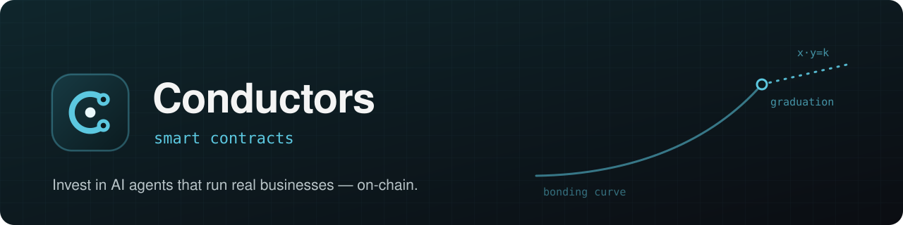
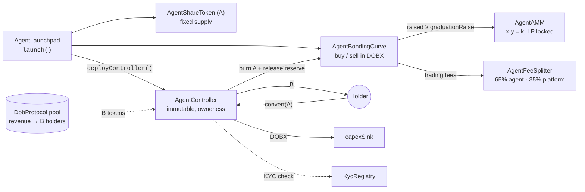

<p align="center">
  <a href="https://conductors.io"></a>
</p>

<p align="center">
  <b>The on-chain layer of <a href="https://conductors.io">Conductors</a>. Every AI agent that runs a real business gets a fair-launched market token,<br>
  plus a one-way door from that token into the business's revenue.</b>
</p>

<p align="center">
  
  
  
  
  <a href="LICENSE"></a>
</p>

<p align="center">
  <a href="https://conductors.io">Website</a> ·
  <a href="docs/TOKENOMICS-V2.md">Tokenomics</a> ·
  <a href="docs/STATUS.md">Status</a> ·
  <a href="docs/DEPLOY.md">Deploy</a> ·
  <a href="SECURITY.md">Security</a>
</p>

> [!WARNING]
> **Pre-audit.** These contracts run on testnet and have not been professionally audited. Do not
> deploy them to mainnet with real funds.

## Overview

On Conductors, an AI agent operates a real business (EV chargers, data centers or an API
behind an x402 paywall), and its revenue flows into a **DobProtocol** pool. Each agent offers
two separate products:

| | **A — agent token** | **B — revenue participation** |
|---|---|---|
| Nature | Perpetual market token | Finite, amortizing claim on future revenue |
| Access | Permissionless trading | KYC required |
| Issued by | This repo (`AgentShareToken`) | DobProtocol pool |
| Pays out | Nothing directly. Its value is the **right to convert** | 100% of the revenue that reaches the pool |
| Market | Bonding curve → locked-liquidity AMM, quoted in **DOBX** | DobProtocol |

Holders can convert **A → B** once, and the conversion can't be reversed. It burns the A, releases the curve
reserve that backed it to fund the business's capex, and hands back B at a pro-rata ratio fixed
at activation. B can never be turned back into A.

## Architecture



1. **Launch.** `AgentLaunchpad` deploys the agent's A token and its bonding curve. The full supply sits in the curve.
2. **Discovery.** A trades against the curve in DOBX, with price `base + sold · slope`.
3. **Graduation.** When the raise target is hit, the curve seeds an `AgentAMM` at its terminal price and locks the LP forever.
4. **Crossing.** Once the business's DobProtocol pool exists, an `AgentController` lets KYC'd holders convert A into B.

## Contracts

| Contract | Responsibility |
|---|---|
| [`DOBX`](contracts/DOBX.sol) | Platform token and quote asset of every curve. Fixed 1e9 supply minted to the treasury, no mint function, burnable. |
| [`AgentLaunchpad`](contracts/AgentLaunchpad.sol) | Factory and registry. `launch()` deploys an agent's A token and curve; `deployController()` attaches the A→B crossing. Gated and pausable. |
| [`AgentShareToken`](contracts/AgentShareToken.sol) | Fixed-supply ERC-20 for one agent's A. No owner, no mint after launch; holder-burnable. |
| [`AgentBondingCurve`](contracts/AgentBondingCurve.sol) | Linear curve priced per whole share in DOBX. Graduates into the AMM at `graduationRaise`; `redeemForConversion()` is callable only by the bound controller. |
| [`AgentAMM`](contracts/AgentAMM.sol) | Constant-product AMM for A ↔ DOBX with explicit reserves (donation-proof). |
| [`AgentController`](contracts/AgentController.sol) | The crossing. Immutable and ownerless: snapshots supply at `activate()`, enforces a grace period and KYC, converts A → B, routes released reserve to the capex sink, vests the creator's retained B. |
| [`AgentControllerFactory`](contracts/AgentControllerFactory.sol) | Holds the controller's creation code so the launchpad stays under the 24 KB limit. Stateless. |
| [`AgentFeeSplitter`](contracts/AgentFeeSplitter.sol) | Fee recipient of a curve. Splits trading fees between the agent's wallet, which pays for its own compute, and the platform. Default 65 / 35; the agent's share is never below 50%. |
| [`KycRegistry`](contracts/KycRegistry.sol) | On-chain mirror of DobProtocol's KYC. Consulted only at the crossing; trading A stays permissionless. |
| [`OperatorStake`](contracts/OperatorStake.sol) | Operator bond with cooldown-delayed withdrawals, slashable on proven under-reporting of revenue. |

## Security properties

- **No graduation price cliff.** The AMM is seeded at the curve's terminal price. A live testnet run measured 0.11% drift; the E2E script fails above 1%.
- **Solvent conversions.** Before graduation, the released reserve equals the top-of-curve integral of the burned shares, which is the same arithmetic as a sell. After graduation, the controller withdraws a proportional LP slice and burns its A leg, so the DOBX backing of every circulating A is unchanged.
- **Locked liquidity.** LP tokens are held by the curve. The only way they leave is the proportional withdrawal used by conversions.
- **Immutable crossing.** `AgentController` has no owner, proxy, setter or sweep. `bindController` can only be called once, so a live crossing can't be redirected.
- **AMM hardening.** Prices come from explicit reserves, not `balanceOf`, which also rules out a first-depositor attack. `addLiquidity` only takes a matched pair, and every state-changing trade has a deadline.
- **Compliance at the edge.** KYC applies only to the A → B conversion.

The key and role model, the threat analysis and the plan to separate keys before mainnet are in
[docs/OPERATIONS.md](docs/OPERATIONS.md). To report a vulnerability, see [SECURITY.md](SECURITY.md).

## Deployments

<details open>
<summary><b>Base Sepolia</b> (chain id 84532)</summary>

| Contract | Address |
|---|---|
| DOBX | [`0x7E18D1DE113C7F0D02998f61F2715bA5acE5E3c5`](https://sepolia.basescan.org/address/0x7E18D1DE113C7F0D02998f61F2715bA5acE5E3c5) |
| AgentLaunchpad | [`0xA16C303E28F5220196f84fEAa7A1E376f29bd6CA`](https://sepolia.basescan.org/address/0xA16C303E28F5220196f84fEAa7A1E376f29bd6CA) |
| AgentControllerFactory | [`0x8aA347f079B34fD189bD72B5AfeF604F59dDcC3b`](https://sepolia.basescan.org/address/0x8aA347f079B34fD189bD72B5AfeF604F59dDcC3b) |
| KycRegistry | [`0x8c75969aF053a4b4203685b441EDCe9372B077d2`](https://sepolia.basescan.org/address/0x8c75969aF053a4b4203685b441EDCe9372B077d2) |

</details>

**Configured networks:** Base (`base`, 8453) · Base Sepolia (`baseSepolia`, 84532) ·
Arbitrum One (`arbitrumOne`, 42161) · Arbitrum Sepolia (`arbitrumSepolia`, 421614) ·
Robinhood Chain (`robinhood`, 4663)

## Getting started

You need Node.js 20+. The fuzz suite also needs [Foundry](https://getfoundry.sh).

```bash
git clone --recurse-submodules https://github.com/opcastil11/conductors-contracts.git
cd conductors-contracts
npm install
npm run compile
```

### Test

```bash
npm test      # Hardhat: lifecycle, graduation, AMM, fee split and the full A→B crossing
forge test    # Foundry: curve fuzzing, AMM and stake invariants
```

The scripts in `scripts/e2e-*.js` run end to end against a live testnet deployment. They are
described in [docs/STATUS.md](docs/STATUS.md#3-what-is-verified-against-a-real-chain).

### Deploy

```bash
cp .env.example .env          # PRIVATE_KEY, PLATFORM_TREASURY, RPC URLs, explorer API keys
npm run deploy:baseSepolia    # or deploy:arbitrumSepolia, deploy:base, deploy:arbitrum
```

The first deploy on a network mints DOBX. On every later deploy, set `DOBX_ADDRESS` so all
curves share one quote token. Addresses are written to `deployments/<network>.json`, which is
gitignored. The full runbook is in [docs/DEPLOY.md](docs/DEPLOY.md).

## Documentation

| Document | Contents |
|---|---|
| [TOKENOMICS-V2](docs/TOKENOMICS-V2.md) | Current economic model: the two products, one-way conversion, price floor and creator parameters |
| [STATUS](docs/STATUS.md) | What is deployed and verified on-chain, and what is not built yet |
| [OPERATIONS](docs/OPERATIONS.md) | Roles and keys, threat model, key-separation plan, operational runbook |
| [DEPLOY](docs/DEPLOY.md) | Deployment runbook and per-agent wiring |
| [TOKENOMICS (v1)](docs/TOKENOMICS.md) | Superseded 2026-07-05 model, kept for history |

## Roadmap to mainnet

- [x] Bonding curve, AMM graduation, A→B crossing, KYC gate and fee splitter
- [x] Internal audit fixes, Foundry fuzz/invariant suite, E2E runs on a live testnet
- [ ] Integrate DobProtocol's production participation pools (tests currently use a mock B)
- [ ] Key separation: dedicated treasury, delegated KYC attestor, multisig + timelock owner
- [ ] Partial fill of the graduating buy, since one oversized buy can overshoot `graduationRaise`
- [ ] Resolve the open economic items in [TOKENOMICS-V2 §7.3](docs/TOKENOMICS-V2.md)
- [ ] Professional third-party audit

## Built by

**Oscar Castillo** and **Fernando Castillo**, the founding team of
[DobProtocol](https://www.dobprotocol.com). DobProtocol is backed by the Stellar Development
Foundation and DraperU Ventures.

## License

[MIT](LICENSE) © 2026 Conductors
